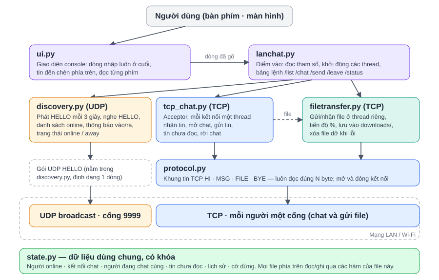
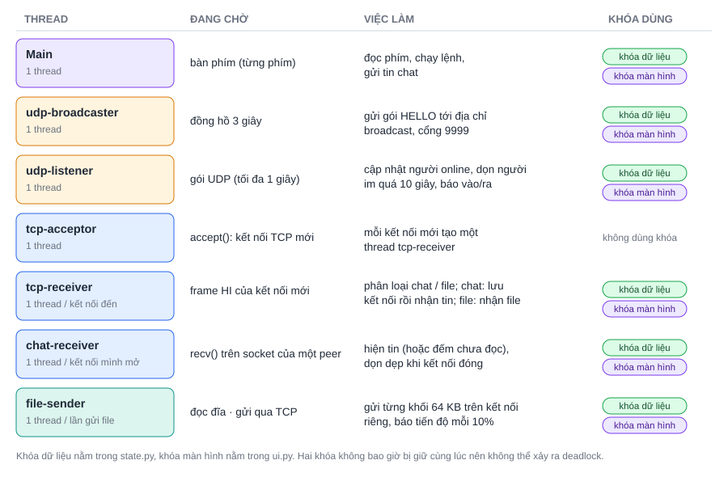
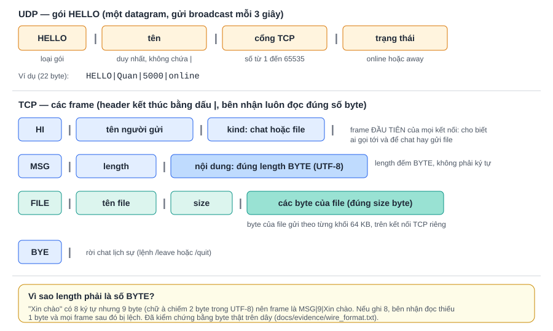
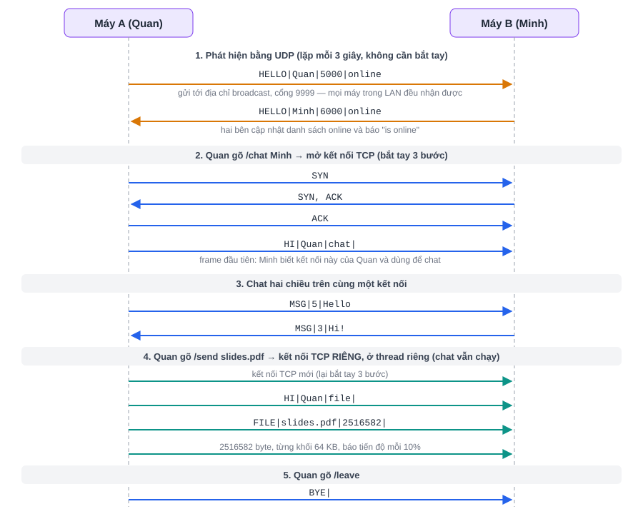
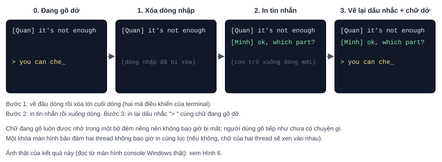
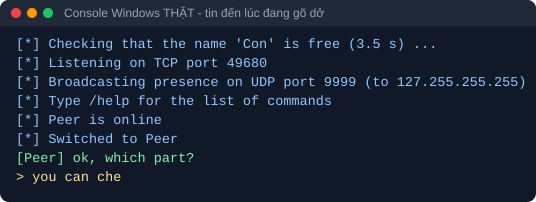
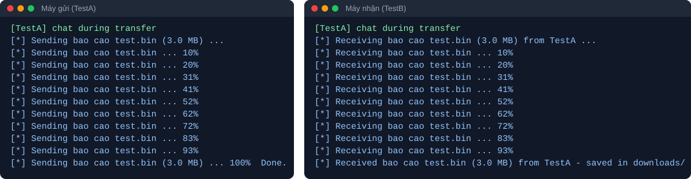
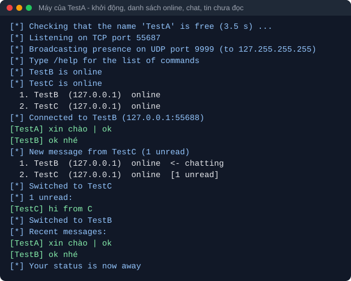
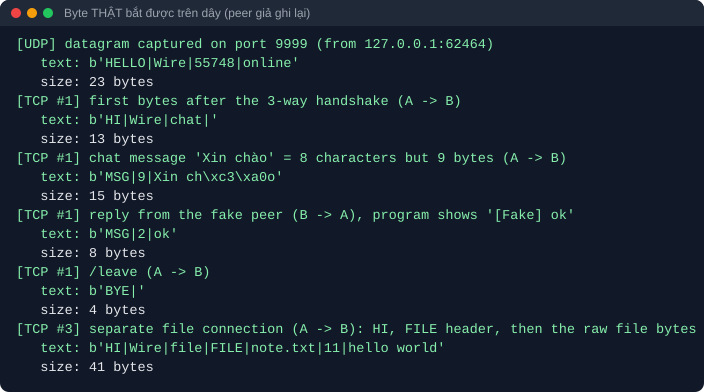

# BÁO CÁO ĐỒ ÁN SOCKET — LAN CHAT & FILE SHARING

**Nhóm:** Lê Nhật Huy · Trần Nguyễn Hồng Ngọc · Trịnh Minh Phong
**Công nghệ:** Python 3.11, chỉ dùng thư viện chuẩn (socket, threading, argparse, os, sys, time) — giao tiếp bằng Socket API gốc của hệ điều hành.
**Môi trường kiểm thử:** Windows 11, nhiều chương trình chạy trên cùng một máy (giao diện loopback). Phần kiểm thử trên hai máy thật và ảnh Wireshark được ghi rõ ở mục 7.

> **Tình trạng minh chứng (cập nhật khi nộp):** đã có — 61 kiểm thử tự động, phiên chạy 3 chương trình thật, byte thật trên dây, kiểm tra trên console Windows thật.
> **Chưa có — nhóm phải làm trên máy thật:** ảnh Wireshark (UDP broadcast, bắt tay 3 bước TCP) và kiểm thử trên 2 máy thật (mục 7).

---

## 1. Giới thiệu và mục tiêu

Chương trình là ứng dụng chat ngang hàng (peer-to-peer) chạy trong console. Mọi người dùng chạy cùng một chương trình; chương trình tự phát hiện những người khác trong mạng LAN, hiển thị ai đang online, cho phép chọn một người để chat và gửi file cho họ. Hai giao thức tầng giao vận được dùng đúng sở trường của mỗi loại:

| Giao thức | Dùng cho | Lý do chọn |
|---|---|---|
| UDP | Phát hiện người dùng và trạng thái online/away | Nhanh, không cần kết nối, gửi broadcast được; mất một gói không sao vì 3 giây sau có gói mới |
| TCP | Chat và truyền file | Tin cậy, đúng thứ tự, không được mất byte nào |

**Bảng đối chiếu yêu cầu của đề với cách đáp ứng**

| Yêu cầu của đề | Cách đáp ứng | Minh chứng |
|---|---|---|
| Phát broadcast mỗi 3 giây, danh sách online, timeout 10 giây, thông báo vào/ra | Thread phát và thread nghe UDP (mục 5.1) | Hình 8, test đầu-cuối "went offline" |
| Trạng thái online/away qua UDP | Trạng thái nằm trong gói HELLO, gửi ngay khi đổi | Hình 8; test "is now away" |
| Chat TCP, nhiều peer, tin của người khác thành "unread" | Mỗi kết nối một thread nhận; kho dữ liệu có khóa (mục 5.2) | Hình 8; test unread |
| Gửi file có tiến độ %, lưu vào thư mục downloads, chat vẫn chạy | Kết nối TCP riêng, thread riêng (mục 5.4) | Hình 7; so sánh mã băm SHA-256 |
| Tin đến không phá dòng đang gõ | Xóa dòng nhập, in tin, vẽ lại dòng nhập (mục 5.3) | Hình 5, Hình 6 |
| Giao thức tự thiết kế, có framing | Bốn frame HI, MSG, FILE, BYE và gói HELLO (mục 4) | Hình 3, Hình 9 |
| Xử lý lỗi: ngắt kết nối, offline, file lỗi, lệnh sai | Bảng ở mục 5.5 | Bảng 6.3 |

## 2. Kiến trúc tổng thể

*Hình 1. Kiến trúc tổng thể: mỗi hộp là một file, mỗi file đảm nhiệm đúng một việc. Mũi tên chỉ chiều gọi.*

Chương trình gồm 8 file (tổng 1464 dòng, trong đó khoảng 880 dòng lệnh và 585 dòng chú thích; file dài nhất 240 dòng):

| Module | Trách nhiệm duy nhất |
|---|---|
| lanchat | Điểm vào: đọc tham số, khởi động các thread, bảng lệnh |
| config | Hằng số: cổng 9999, chu kỳ 3 giây, timeout 10 giây, kích thước khối 64 KB |
| state | Dữ liệu dùng chung giữa các thread và khóa bảo vệ chúng |
| protocol | Khung tin TCP, đọc đúng N byte, mở và đóng kết nối |
| discovery | UDP: phát và nghe HELLO, danh sách online, trạng thái |
| tcp_chat | TCP chat: nhận kết nối, nhận tin, mở chat, gửi tin, rời chat |
| filetransfer | Gửi và nhận file, tiến độ, tên file an toàn |
| ui | Dòng nhập ở cuối màn hình, in tin phía trên, đọc từng phím |

Nguyên tắc thiết kế: các tầng chỉ gọi xuống, không gọi ngược (giao diện và điều phối gọi chức năng; chức năng gọi giao thức và dữ liệu); một file một việc để dễ đọc, dễ giải thích và dễ kiểm thử riêng từng phần.

## 3. Mô hình thread và đồng bộ

*Hình 2. Các thread, thứ chúng đang chờ, việc chúng làm và khóa chúng dùng.*

Mỗi thread chờ một loại sự kiện khác nhau nên không thread nào chặn thread nào. Điểm mấu chốt của yêu cầu "nhận tin bất cứ lúc nào": lời gọi nhận dữ liệu của TCP là lời gọi chặn, nên mỗi kết nối phải có thread nhận riêng; nếu dùng chung một thread thì một người im lặng sẽ làm kẹt mọi người khác. Việc gửi file chạy ở thread riêng để thread chính vẫn nhận phím và hiển thị tin.

**Dữ liệu dùng chung và khóa.** Có đúng hai khóa trong toàn chương trình:

| Khóa | Bảo vệ | Các thread tranh chấp |
|---|---|---|
| Khóa dữ liệu (module state) | Tên mình, danh sách người online, kết nối chat, người đang chat cùng, số tin chưa đọc, lịch sử | Thread nghe UDP và các thread nhận tin ghi; thread chính đọc và ghi; thread gửi file đọc |
| Khóa màn hình (module ui) | Màn hình và chữ đang gõ dở | Mọi thread khi in ra |

**Ba quy tắc chống deadlock** (khóa của Python không cho phép một thread xin lại khóa mà nó đang giữ):
1. Các hàm của kho dữ liệu tự lấy và tự nhả khóa, không in ra màn hình và không gọi lẫn nhau khi đang giữ khóa.
2. Hai khóa không bao giờ bị giữ cùng lúc: dữ liệu được sửa trong khóa dữ liệu, ra khỏi khóa rồi mới in (xin khóa màn hình).
3. Khi người dùng bấm Enter, chương trình chỉ lấy dòng chữ ra trong khóa màn hình, nhả khóa rồi mới chạy lệnh. Nếu chạy lệnh khi còn giữ khóa, lệnh cần in ra sẽ xin lại khóa và treo vĩnh viễn.

Kho dữ liệu luôn trả về bản sao, nên thread bên ngoài duyệt danh sách thoải mái dù thread khác đang sửa. Một cờ dừng dùng chung được bật khi người dùng thoát; mọi thread nền đều là daemon và tự thoát ở vòng lặp kế tiếp.

## 4. Thiết kế giao thức

*Hình 3. Gói UDP HELLO và bốn frame TCP.*

### 4.1 UDP: gói HELLO
Một datagram văn bản gồm bốn trường ngăn cách bằng dấu gạch đứng: loại gói, tên, cổng TCP, trạng thái (ví dụ HELLO|Quan|5000|online, dài 22 byte). Địa chỉ IP của người gửi lấy từ chính datagram nên không cần nằm trong gói. Quy tắc bên nhận: bỏ qua gói sai định dạng, bỏ qua gói do chính mình phát, và coi một người là offline nếu 10 giây không nghe thấy họ. Tên phải duy nhất; để bảo đảm, lúc khởi động chương trình nghe 3,5 giây (lâu hơn chu kỳ 3 giây của mọi peer) trước khi tự phát; nếu nghe thấy tên của mình thì từ chối khởi động.

### 4.2 TCP: framing
TCP là dòng byte không có ranh giới tin nhắn: hai lần gửi liền nhau có thể được nhận thành một lần, hoặc một lần gửi bị chia làm nhiều lần nhận. Vì vậy mọi frame bắt đầu bằng header cho biết loại và độ dài, bên nhận đọc đúng số byte đó. Bốn frame được dùng:

| Frame | Định dạng | Ý nghĩa |
|---|---|---|
| Giới thiệu | HI, tên người gửi, kiểu kết nối | Frame đầu tiên của mọi kết nối. Kiểu là "chat" hoặc "file" |
| Tin nhắn | MSG, độ dài, nội dung | Độ dài là số BYTE của nội dung UTF-8 |
| File | FILE, tên file, kích thước, rồi các byte của file | Chỉ chứa tên file, không có đường dẫn |
| Kết thúc | BYE | Rời chat lịch sự |

Cách đọc: đọc từng byte đến dấu gạch đứng đầu tiên để biết loại frame; đọc tiếp các trường của header; với tin nhắn và file thì lặp đọc cho đến khi đủ đúng số byte đã khai báo. Header chỉ dài vài chục byte nên đọc từng byte không đáng kể, đổi lại không bao giờ đọc lẹm sang dữ liệu phía sau.

**Hai quyết định thiết kế đáng chú ý.**
- *Độ dài tính bằng byte, không phải ký tự.* "Xin chào" có 8 ký tự nhưng 9 byte vì chữ "à" chiếm hai byte trong UTF-8. Đã kiểm chứng bằng byte thật bắt được trên dây: frame là MSG|9|Xin chào (xem Hình 9). Nếu ghi 8, bên nhận đọc thiếu một byte và toàn bộ frame sau đó bị lệch.
- *Frame HI có thêm trường kiểu kết nối* (khác mẫu của đề). Máy nhận chỉ thấy địa chỉ và cổng tạm của người gọi, không biết họ là ai và muốn chat hay gửi file. Nếu không có trường này, một kết nối gửi file có thể bị nhầm là kết nối chat và đè lên kết nối chat thật.

*Hình 4. Luồng hoạt động: phát hiện bằng UDP, bắt tay 3 bước, chat hai chiều, gửi file bằng kết nối riêng, rời chat.*

### 4.3 Xử lý lỗi theo giao thức
| Tình huống | Bên phát hiện | Cách xử lý |
|---|---|---|
| Header sai, độ dài không phải số, loại frame lạ, độ dài quá lớn (quá 1 MB) | Bên nhận | Từ chối frame, đóng kết nối đó, chương trình vẫn chạy |
| Kết nối mới không gửi HI trong 5 giây | Máy nhận | Đóng kết nối (chống kết nối rác chiếm thread) |
| Đối phương đóng hoặc mất kết nối giữa chat | Thread nhận | Báo "disconnected", gỡ kết nối, nếu là người đang chat cùng thì kết thúc chat |
| Nhận file mà 30 giây không có byte nào, hoặc người gửi đóng sớm | Máy nhận | Xóa file dở và báo lỗi |
| Kết nối chat mới đến khi đã có kết nối cũ cùng tên | Máy nhận | Kết nối mới thay kết nối cũ (kết nối cũ thường đã chết do đối phương khởi động lại) |

## 5. Chi tiết các chức năng

### 5.1 Phát hiện người dùng và trạng thái (UDP)
Hai thread: thread phát chờ đồng hồ 3 giây rồi gửi gói HELLO tới địa chỉ broadcast cổng 9999; thread nghe chờ gói UDP tối đa 1 giây mỗi lần. Giới hạn 1 giây là có chủ đích: nếu chờ vô hạn thì khi không ai gửi gì, bước dọn những người im quá 10 giây sẽ không bao giờ chạy. Người mới xuất hiện được báo "is online", người biến mất báo "went offline", người đổi trạng thái báo "is now away". Khi người dùng đổi trạng thái, thread phát được đánh thức để gửi ngay, người khác không phải chờ tối đa 3 giây. Nhiều chương trình trên cùng một máy cùng nghe cổng 9999 nhờ bật tùy chọn dùng chung cổng trước khi gắn cổng; muốn gửi tới địa chỉ broadcast phải bật quyền broadcast cho socket. Danh sách được sắp theo tên nên số thứ tự trong lệnh danh sách và lệnh mở chat luôn khớp nhau.

### 5.2 Chat TCP với nhiều người
Mỗi cặp người có một kết nối chat duy nhất, đi hai chiều; cả bên gọi và bên nhận đều có thread nhận riêng. Người dùng mở chat theo tên hoặc theo số trong danh sách. Chuyển sang người khác không đóng kết nối cũ: tin của họ vẫn đến ngầm và được đếm. Tin của người không phải người đang chat cùng được lưu lại và hiện thông báo kèm số tin chưa đọc; khi mở chat với họ, các tin này được in lại rồi bộ đếm về 0 (Hình 8). Mọi lần gửi trên một socket chat đều do thread chính thực hiện, nên byte của hai frame không bao giờ trộn lẫn. Khi rời chat, chương trình gỡ kết nối khỏi kho dữ liệu trước rồi mới đóng socket, để thread nhận biết đây là chủ ý và không báo "mất kết nối" sai.

### 5.3 Giao diện console: gõ dở mà tin vẫn đến

*Hình 5. Cơ chế giả lập "khung nhập" trong console.*

Console không có vùng riêng, nên dòng cuối màn hình luôn là dòng nhập và phần trên là lịch sử. Chương trình đọc từng phím (không đợi Enter) và nhớ chữ đang gõ trong một bộ đệm. Khi có tin đến, thread nhận làm ba bước trong khóa màn hình: xóa dòng nhập hiện tại, in tin rồi xuống dòng, vẽ lại dấu nhắc cùng chữ đang gõ dở. Phím Backspace vẽ lại cả dòng nên đúng cả với ký tự rộng. Phím mũi tên và phím chức năng bị bỏ qua. Chế độ không tương tác (đầu vào là pipe) bỏ mã điều khiển và đọc từng dòng, dùng cho kiểm thử tự động.

*Hình 6. Kết quả đọc lại từ màn hình console Windows thật sau khi chương trình kiểm tra bơm phím thật vào console: người dùng đang gõ "you can che" thì tin của Peer đến; tin chèn lên trên, dòng nhập vẫn là "you can che" (nguồn: evidence/console_typing_while_receiving.txt). Đây là hình dựng lại từ nội dung màn hình thật, không phải ảnh chụp cửa sổ.*

### 5.4 Truyền file
Mỗi lần gửi file là một kết nối TCP riêng và một thread riêng. Người gửi mở kết nối, gửi frame HI kiểu "file", frame FILE kèm tên và kích thước, rồi đọc file từng khối 64 KB gửi đi (không bao giờ nạp cả file vào bộ nhớ). Tiến độ phần trăm được báo mỗi 10% để không làm tràn màn hình và không phá dòng nhập. Người nhận đọc đúng số byte đã khai báo, ghi ra thư mục downloads, và báo khi xong.

Các biện pháp an toàn ở phía nhận: tên file từ mạng bị coi là không đáng tin nên chỉ giữ phần tên cuối, thay ký tự cấm của Windows và tên dành riêng (như CON, NUL); tên trùng được đổi thành dạng "tên(1).đuôi" bằng cách chỉ cho phép tạo file mới, không bao giờ ghi đè. Nếu kết nối đứt hoặc người gửi đóng sớm, file dở bị xóa và người dùng được báo lỗi. Chữ "Done" bên gửi nghĩa là đã đưa hết byte cho TCP; việc kiểm tra đủ byte là của bên nhận.

*Hình 7. Máy gửi và máy nhận cùng báo tiến độ mỗi 10% khi truyền file 3 MB; dòng chat "chat during transfer" đến nơi trong lúc đang truyền (nguồn: evidence/session_TestA.txt và session_TestB.txt).*

### 5.5 Xử lý lỗi và độ ổn định
| Tình huống | Hành vi của chương trình |
|---|---|
| Đối phương tắt đột ngột | Báo mất kết nối ngay, hết chat; sau 10 giây báo offline |
| Mở chat tới người vừa tắt (còn trong danh sách) | Báo lỗi không kết nối được sau tối đa 3 giây, không treo |
| Mở chat với tên không tồn tại hoặc với chính mình | Báo lỗi rõ ràng |
| Gửi file không tồn tại; gửi khi chưa mở chat | Báo lỗi ngay, không gửi gì |
| Lệnh sai | Báo "Unknown command" và in danh sách lệnh |
| Lỗi bất ngờ trong một lệnh | Bị bắt lại, báo lỗi, chương trình không chết |
| Hai người trùng tên | Người đến sau bị từ chối khởi động |
| Cổng TCP đã bị chiếm | Báo lỗi và gợi ý đổi cổng |

## 6. Kiểm thử và minh chứng

### 6.1 Phương pháp
Bốn lớp kiểm thử bổ sung cho nhau:
1. **Kiểm thử đơn vị (52 kiểm thử, cộng 5 kiểm tra quy tắc tổ chức dự án):** khung giao thức, gói HELLO, kho dữ liệu (kể cả 8 thread cùng ghi), tên file an toàn, nhận file đủ và đứt giữa chừng, tiến độ, vẽ lại dòng nhập với phím giả. Không cần mạng.
2. **Kiểm thử đầu-cuối (3 kiểm thử):** chạy 3 chương trình thật cùng lúc, qua UDP và TCP thật, và cho chúng chat, gửi file 3 MB (so sánh SHA-256 trước và sau), gây lỗi, tắt đột ngột một chương trình.
3. **Quan sát byte trên dây:** một "peer giả" ghi lại từng byte mà chương trình thật gửi ra, đối chiếu với đặc tả giao thức (Hình 9).
4. **Console thật:** bơm phím thật vào console Windows thật và đọc lại màn hình (Hình 6).

Để kiểm tra bản thân các kiểm thử có tác dụng, đã cố ý phá code ở 5 chỗ (tính độ dài bằng ký tự thay vì byte; đọc thiếu byte; không xóa file dở; không vẽ lại chữ đang gõ; hiện mọi tin thay vì đếm chưa đọc). Cả 5 lần đều có kiểm thử báo đỏ.

### 6.2 Kết quả
Toàn bộ 61 kiểm thử chạy trong 25,6 giây, tất cả đạt, không kiểm thử nào bị bỏ qua (gồm 52 đơn vị, 5 kiểm tra quy tắc dự án trong đó có kiểm tra báo cáo này không chứa code và đủ ảnh, 4 kiểm thử chạy mạng thật). Chi tiết: evidence/test_results.txt.

*Hình 8. Màn hình của một chương trình: khởi động, thấy hai người online, danh sách (đánh dấu người đang chat và số tin chưa đọc), chat, tin của người thứ ba thành "1 unread", chuyển người chat và in lại tin chưa đọc. Dòng lệnh gõ vào không hiện lại trong bản ghi tự động (nguồn: evidence/session_TestA.txt).*

*Hình 9. Các byte thật bắt được: gói UDP HELLO, frame HI, tin tiếng Việt 8 ký tự nhưng độ dài 9, tin trả lời, frame BYE, và kết nối riêng cho file (HI, FILE, rồi byte của file). Bản đầy đủ kèm mã hex: evidence/wire_format.txt.*

### 6.3 Ma trận tình huống lỗi
| Tình huống | Minh chứng | Kết quả |
|---|---|---|
| Đối phương rời chat bằng lệnh rời chat | Kiểm thử đầu-cuối | Đạt |
| Đối phương bị tắt đột ngột | Kiểm thử đầu-cuối: báo mất kết nối, sau đó báo offline | Đạt |
| Mở chat tới người vừa tắt nhưng còn trong danh sách | Kiểm thử đầu-cuối: báo không kết nối được | Đạt |
| Mở chat tên không tồn tại; với chính mình | Kiểm thử đầu-cuối | Đạt |
| Gửi file không tồn tại; gửi khi chưa mở chat | Kiểm thử đơn vị và đầu-cuối | Đạt |
| Đứt giữa lúc nhận file: xóa file dở | Kiểm thử đơn vị (người gửi đóng sớm) | Đạt |
| Lệnh sai | Kiểm thử đầu-cuối | Đạt |
| Tin của người không phải người đang chat cùng | Kiểm thử đầu-cuối: đếm chưa đọc, mở chat thấy tin cũ | Đạt |
| Tin tiếng Việt, emoji, chứa dấu gạch đứng, rỗng, rất dài | Kiểm thử đơn vị và byte trên dây | Đạt |
| Hai chương trình trùng tên | Kiểm thử đầu-cuối: chương trình thứ hai thoát với mã lỗi | Đạt |
| Gửi file 3 MB trong lúc chat | Kiểm thử đầu-cuối: SHA-256 trùng khớp | Đạt |
| Tin đến lúc đang gõ dở | Kiểm thử đơn vị và console thật | Đạt |
| Cổng TCP trùng | Kiểm thử đầu-cuối: chương trình thứ hai thoát với thông báo cổng đã bị chiếm | Đạt |
| Chạy trên **hai máy thật** (tường lửa, Wi-Fi) | **Chưa thực hiện** | Nhóm cần làm |

## 7. Wireshark: UDP broadcast và bắt tay 3 bước TCP

> ⚠ **CHƯA CÓ ẢNH — nhóm phải chụp trên 2 máy thật rồi chèn vào đây.** Không thể tạo ảnh này bằng chương trình trên một máy: gói broadcast qua giao diện loopback và gói giữa hai máy qua Wi-Fi khác nhau. Cách chụp từng bước: file docs/WIRESHARK.md. Lưu ảnh vào docs/img rồi thay khối này bằng ảnh và giữ phần giải thích bên dưới.

**Ảnh cần chụp 1 — gói UDP broadcast** (bộ lọc: cổng UDP 9999). Cần thấy: địa chỉ đích là địa chỉ broadcast (255.255.255.255 hoặc địa chỉ mạng con kết thúc bằng .255), cổng đích 9999, và phần dữ liệu là chuỗi HELLO với tên, cổng, trạng thái; cứ khoảng 3 giây có một gói.

*Giải thích chuẩn bị sẵn:* UDP không có bước thiết lập kết nối nên một gói là đủ để thông báo "tôi đang online". Địa chỉ đích broadcast khiến mọi máy trong mạng con nhận cùng một gói mà người gửi không cần biết địa chỉ ai. Chu kỳ 3 giây cân bằng giữa độ tươi của danh sách và lưu lượng; nếu mất một gói thì 3 giây sau có gói khác nên việc mất gói UDP chấp nhận được. Router không chuyển tiếp broadcast ra ngoài mạng con nên chỉ người trong cùng mạng thấy nhau.

**Ảnh cần chụp 2 — bắt tay 3 bước TCP** (bộ lọc: cổng TCP của chương trình, hoặc gói có cờ SYN). Bắt đầu chụp trước khi gõ lệnh mở chat. Cần thấy ba gói đầu: SYN (bên gọi tới bên nghe), SYN kèm ACK (bên nghe trả lời), ACK (bên gọi xác nhận); ngay sau đó là gói mang dữ liệu đầu tiên chứa HI.

*Giải thích chuẩn bị sẵn:* gói SYN mang số thứ tự khởi đầu của bên gọi; gói SYN-ACK vừa xác nhận số đó (số xác nhận bằng số thứ tự cộng 1) vừa đưa ra số thứ tự khởi đầu của bên nghe; gói ACK xác nhận số của bên nghe. Ba bước cần thiết để hai bên đồng bộ số thứ tự theo cả hai chiều, nền tảng cho việc TCP đánh số, xác nhận và truyền lại byte. Ảnh thứ ba (tùy chọn) là chức năng theo dõi luồng TCP, hiển thị HI rồi MSG, minh họa framing; có thể đối chiếu với Hình 9.

## 8. Khó khăn gặp phải và hướng giải quyết

| # | Khó khăn | Nguyên nhân | Giải pháp | Cách kiểm chứng |
|---|---|---|---|---|
| 1 | Tin nhắn dính nhau hoặc bị cắt đôi | TCP là dòng byte, không có ranh giới tin | Header có loại và độ dài; đọc đúng N byte bằng vòng lặp | Kiểm thử gửi hai tin liền nhau, gửi 5+5 byte cách quãng |
| 2 | Tiếng Việt làm lệch toàn bộ frame | Độ dài tính bằng ký tự nhỏ hơn số byte UTF-8 | Header ghi số byte | Byte thật trên dây: 8 ký tự, 9 byte |
| 3 | Hai chương trình dùng chung một cổng TCP mà không báo lỗi trên Windows | Tùy chọn dùng chung cổng trên Windows cho phép bind lần hai thành công | Dùng tùy chọn độc quyền cổng trên Windows | Thử trực tiếp: lần bind thứ hai thành công với tùy chọn dùng chung, báo lỗi 10048 với tùy chọn độc quyền |
| 4 | Nhiều chương trình một máy phải nghe chung cổng UDP 9999 | Mặc định một cổng chỉ một chủ | Bật dùng chung cổng trước khi gắn cổng | Ba chương trình cùng thấy nhau |
| 5 | Nhận lại gói của chính mình; hai người trùng tên | Broadcast tới cả người gửi; danh sách khóa theo tên | Lọc theo tên; kiểm tra tên lúc khởi động bằng cách nghe 3,5 giây | Kiểm thử chương trình trùng tên bị từ chối |
| 6 | Chương trình treo khi tin đến lúc đang xử lý lệnh | Khóa không cho xin lại; lệnh chạy trong khi giữ khóa màn hình | Lấy dòng chữ ra trong khóa, chạy lệnh ngoài khóa | Kiểm thử vòng nhập phím; console thật |
| 7 | Thread nhận tin báo "mất kết nối" sai khi mình chủ động rời chat; hoặc kẹt ở lệnh nhận khi socket đóng | Đóng socket từ thread khác; thread nhận không biết đó là chủ ý | Gỡ kết nối khỏi kho dữ liệu trước; tắt hai chiều socket trước khi đóng để đánh thức thread kẹt | Kiểm thử đầu-cuối: rời chat, không có thông báo thừa |
| 8 | Kết nối gửi file có thể đè lên kết nối chat | Cả hai đến cùng một cổng; máy nhận không biết mục đích | Thêm kiểu kết nối vào frame HI | Byte trên dây: HI chat và HI file |
| 9 | Kết nối rác hoặc người gửi im lặng làm treo thread | Lệnh nhận chặn vô hạn | Hạn 5 giây cho HI, 30 giây cho file đang nhận | Kiểm thử nhận file đứt giữa chừng |
| 10 | Tên file độc hại ghi ra ngoài thư mục downloads | Tên đến từ mạng | Chỉ giữ tên cuối, thay ký tự cấm, chỉ tạo file mới | Kiểm thử tên "..\..\evil.exe", tên trùng |
| 11 | Khó kiểm thử giao diện nhập phím tự động | Phím đọc từ console, không đi qua pipe | Chế độ đọc dòng cho kiểm thử, kèm bơm phím thật vào console thật | Hình 6 |
| 12 | Broadcast có thể không tới trên máy nhiều card mạng hoặc Wi-Fi bật cách ly | Địa chỉ 255.255.255.255 đi qua card mặc định | Tham số chọn địa chỉ broadcast; demo bằng điểm phát Wi-Fi riêng | Cần thử trên máy thật (mục 6.3) |

## 9. Hạn chế đã biết và hướng phát triển
- Dòng gõ dài hơn bề rộng cửa sổ, ký tự rộng (emoji) và phím mũi tên, Home, End chưa được hỗ trợ trong cách vẽ lại thủ công. Phương án thay thế là thư viện giao diện dòng nhập chuyên dụng.
- Nhánh đọc phím cho Linux và macOS được viết theo mẫu của đề nhưng nhóm chưa chạy thử.
- Nếu hai người cùng mở chat với nhau trong cùng một phần nghìn giây, kết nối này có thể thay kết nối kia và cả hai thấy báo "mất kết nối"; mở lại là được.
- Gửi file chỉ được khi người nhận còn trong danh sách UDP. "Done" nghĩa là bên gửi đã đưa hết byte cho TCP, không phải xác nhận ghi đĩa xong từ bên nhận.
- Chưa mã hóa nội dung; không xác thực người dùng (ai trong mạng cũng có thể dùng tên bất kỳ chưa bị chiếm).
- Hướng phát triển: xác nhận hoàn tất file, kiểm tra toàn vẹn bằng mã băm, chat nhóm, giao diện đồ họa.

## 10. Cách chạy, kiểm thử và phân công
Hướng dẫn cài đặt, chạy một máy, chạy hai máy, lệnh và kiểm thử nằm trong README của dự án. Cách đọc mã nguồn theo thứ tự và luồng từng chức năng: docs/HUONG_DAN_DOC_CODE.md. Đặc tả giao thức đầy đủ: docs/PROTOCOL.md. Kế hoạch, phân công và câu hỏi ôn vấn đáp: docs/KE_HOACH.md.

| Thành viên | Module chính | Phần giải thích khi vấn đáp |
|---|---|---|
| Lê Nhật Huy | protocol, tcp_chat, lanchat | Giao thức, framing, chat TCP, điều phối |
| Trần Nguyễn Hồng Ngọc | discovery, kiểm thử, Wireshark | UDP, danh sách online, trạng thái, ma trận lỗi |
| Trịnh Minh Phong | ui, filetransfer | Giao diện nhập, truyền file |

**Tài liệu tham khảo:** đề bài đồ án Socket Programming (LAN Chat & File Sharing); Beej's Guide to Network Programming; tài liệu thư viện socket và threading của Python.
